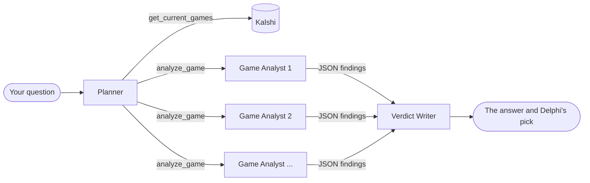

Delphi looks at the NBA games on Kalshi for one night and answers two questions about each of them:
who does the crowd think will win, and what would happen If I place an order?

The first answer is the Kalshi price 3 minutes before the beginning. The second one comes from calling a tool,
`simulate_order`, that walks Kalshi's live order book for the amount you type: how many contracts you would get, at
what average price, and what you would win or lose.

---

To run it locally, you can just:

1. Set up a Google Cloud project.
2. Enable the [Agent Platform API](https://console.cloud.google.com/apis/library/aiplatform.googleapis.com).
3. Clone the repository and navigate to the project folder:

   ```
   git clone https://github.com/lucabarattini/delphi.git
   cd delphi
   ```

4. Run `gcloud auth application-default login`. If your default gcloud project is not the one from
   step 1, add `VERTEXAI_PROJECT=<that project>` to a `.env` file in the folder.
5. Run `uv run app.py`, then open http://localhost:8000.

### Or, you could just use [delphi.cloud.run](https://delphi.cloud.run) :)
---

### Where the data comes from

| File | What is in it |
| --- | --- |
| [`data/games.csv`](data/games.csv) | Every NBA game since October 2024 (2,993 games), from the [Kaggle NBA dataset](https://www.kaggle.com/datasets/eoinamoore/historical-nba-data-and-player-box-scores). |
| [`data/kalshi_t3.csv`](data/kalshi_t3.csv) | One row per past Kalshi game market (3,328 markets): bid and ask 5, 3 and 1 minutes before tip-off, and whether that team won. |

Both files are written by [`build.py`](build.py). 

---

### The three agents

Delphi splits the work between three agents, so that each one has a single job and a short context.


The game cards rendered on the right in the website are built from the tool results, not from the Writer's text, so they can't show hallucinated numbers. 
The middle pane shows every agent's context while it grows, including the JSON
the agents pass to each other.

A few hard limits keep every answer under 5 minutes: at most 15 Game Analysts, 8 of them at a time, 4 turns each, and
4 minutes for the research. If the time runs out, the Writer answers with what came back.

| Tool | Called by | What it does |
| --- | --- | --- |
| `get_current_games` | Planner | The night's games on Kalshi: both markets with bid and ask, game time and the crowd's favorite.|
| `analyze_game` | Planner | Starts one Game Analyst on one game. |
| `get_historical_records` | Game Analyst | A team's record before that night, every game this season with whether Kalshi's favorite won.|
| `get_historical_bets` | Game Analyst | How often teams  won. |
| `simulate_order` | Planner | Walks the live order book on the hunt for various amount: contracts, average price, fee, payout and loss.|

All three agents run on Gemini 4 Argon through LiteLLM and Vertex AI, with low reasoning effort.

Conversations are kept in memory for your session only.

---

### Try it by asking the following demo questions

TBD based on the output when I will run it after all the changes