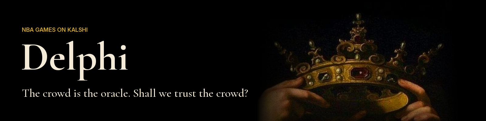

Delphi looks at the NBA games on Kalshi for one night and answers two questions about each of them:
who does the crowd think will win, and what would happen If I place an order?

The first answer is the Kalshi price 3 minutes before tip-off. The second one comes from calling a tool ...

---

To run it locally, you can just:

1. Set up a Google Cloud project.
2. Enable the [Agent Platform API](https://console.cloud.google.com/apis/library/aiplatform.googleapis.com).
3. Clone the repository and navigate to the project folder:

   ```
   git clone https://github.com/lucabarattini/delphi.git
   cd delphi
   ```

4. Run `gcloud auth application-default login`. If your default gcloud project is not the one from
   step 1, add `VERTEXAI_PROJECT=<that project>` to a `.env` file in the folder.
5. Run `uv run app.py`, then open http://localhost:8000.

### Or, you could just use [delphi.cloud.run](https://delphi.cloud.run) :)
---

### Where the data comes from

| File | What is in it |
| --- | --- |
| [`data/games.csv`](data/games.csv) | Every NBA game since October 2024 (2,993 games), from the [Kaggle NBA dataset](https://www.kaggle.com/datasets/eoinamoore/historical-nba-data-and-player-box-scores). |
| [`data/kalshi_t3.csv`](data/kalshi_t3.csv) | One row per past Kalshi game market (3,328 markets): bid and ask 5, 3 and 1 minutes before tip-off, and whether that team won. |

Both files are written by [`build.py`](build.py). 

---

### The three agents

Delphi splits the work between three agents, so that each one has a single job and a short context.


| Agent | What it does | What it hands on |
| --- | --- | --- |
| **Planner** | Reads your question and fetches the night's games from Kalshi. If the question is vague ("New York": the Knicks or the Nets?), it asks back. If Delphi has no data for it (player stats, futures), it says so. Otherwise it sends one Game Analyst per game, all at the same time. | The games to study, or a question back to you. |
| **Game Analyst** | Studies one game, in a fresh context. It pulls both teams' season, how often Kalshi's favorite won in their games, and how often teams at tonight's price won. It copies every number from the tools and never computes one. | One line of JSON per game, every number with its source. |
| **Verdict Writer** | Reads your question and the JSON from every Game Analyst. It has no tools. It writes two lines: the answer, and Delphi's pick, the team it would back and why. Every number links to where it came from. | The answer in the chat. |

The game cards on the right are built in code from the tool results, not from the Writer's text, so they can't show
a number that a tool did not return. The middle pane shows every agent's context while it grows, including the JSON
the agents pass to each other.

A few limits keep every answer under 5 minutes: at most 15 Game Analysts, 8 of them at a time, 4 turns each, and
4 minutes for the research. If the time runs out, the Writer answers with what came back.

| Tool | Called by | What it does |
| --- | --- | --- |
| `get_current_games` | Planner | The night's games on Kalshi: both markets with bid and ask, tip-off and the crowd's favorite. Live prices tonight, prices 3 minutes before tip-off for a past night. |
| `analyze_game` | Planner | Starts one Game Analyst on one game. It lives in [`scripts/oracle.py`](scripts/oracle.py) with the three agents; the other four are in [`scripts/tools.py`](scripts/tools.py). |
| `get_historical_records` | Game Analyst | A team's record before that night, every game this season with whether Kalshi's favorite won, and the last 3 games against the opponent. |
| `get_historical_bets` | Game Analyst | How often teams priced like this one won this season. |
| `simulate_order` | Planner | Walks the live order book for an amount: contracts, average price, fee, payout and loss. Tonight's games only. |

All three agents run on Gemini 4 Argon through LiteLLM and Vertex AI, with low reasoning effort.

Conversations are kept in memory for your session only.

---

### Try it by asking the following demo questions

TBD based on the output when I will run it after all the changes